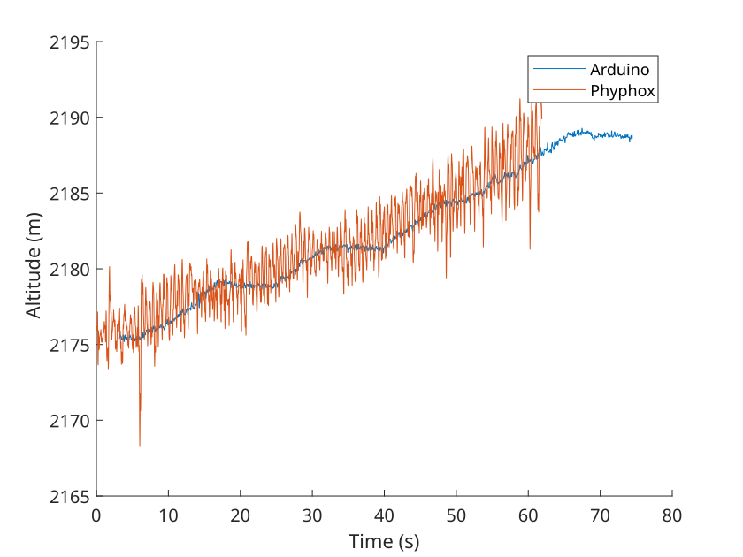

# Rocket instrumentation

You are developing a flight controller for your rocket interceptor. When complete, the controller should:
- record altitude data (during flight only)
- identify key flight events
- trigger intercept at specified flight position
- deploy a parachute at apogee

These development goals will not be completed during this course. You are responsible for developing the following incremental goals. 
- record altitude during a launch event (can include pre- and post-flight data)
- identify flight phases 
	- on pad
	- thrust
	- coast
	- under parachute
	- complete

If time permits, you should also work on the following stretch goals (bonus for this course). 
- record AGL altitude (above ground level)
- identify apogee

Hardware development is complete for this phase of the program. Software development is nearly complete. 

## Objectives

Gain microcontroller programming skills. 
Understand system test. 

## Authorized Resources
Writing: AI level 2
Code: AI level 4 

# Part 0: Verify functionality
## Upload and check data
Open this folder ('rocket_instrumentation') in VSCode. 
Read and understand the provided code in 'main.cpp'. Pay specific attention to the flight phase logic and error blink sequences. 

Use the pioarduino extension to upload the program to your flight controller. 

Install the serial-plotter extension in VSCode. Use the extension to monitor the outputs. Ensure they are all make sense (magnitude, direction). 

## Flight profile
Refer to your rocket prediction. Move the flight controller through a simulated flight profile. Verify the readings make sense. Make a not of any changes you will need to make when analyzing flight data, specifically -1/0/+1 g adjustments at various points of flight. 

# Part 1: Altimeter test
Demonstrate that your altimeter can operate on battery power and accurately record altitude changes over a range *greater than* 10 m. 

Record altitude data from an external source alongside your flight computer throughout your test. 

# Part 2: Flight phase transitions

Modify the provided arduino code to identify transitions between flight phases. The provided code identifies 5 distinct phases of flight. 

- on pad
- thrust
- coast
- under parachute
- complete

However, the logic to transition between flight phases is missing (on pad → thrust is provided for reference). Use your knowledge of expected flight trajectory events to transition between flight phases. The first transition (on pad → thrust) is provided in a `switch`-`case` statement. `switch`-`case` is analogous to multiple if/elseif statements. 

> [!NOTE]
> Your altimeter will record flight phase for post-flight analysis, but will not use it for any in-flight purpose. Flight phase information *could* be used to perform events during flight, such as parachute deployment or turning off data recording after the rocket lands on the ground. 

Using your knowledge of the expected flight profile, test your flight phase transition logic. Record test data. Create a plot showing relevant data along with phase transitions. 

> [!NOTE]
> You may need to use different thresholds for your test. If so, make sure you change them back before launch.

## Optional extra
Modify the code to identify apogee. 

# Part 3: Write draft paper
Write new sections of your semester-long rocket paper. See instructions in [../paper/ASSIGNMENT_INSTRUCTIONS.md](../paper/ASSIGNMENT_INSTRUCTIONS.md). 

You will submit this paper 3 times. Bring a printed copy to class each time. 
1. draft to get reviewed by a peer
2. reviewed draft of your peer's paper
3. submit to instructor 

### submission
- [ ] update paper on overleaf
  - [ ] paste link here: (your overleaf share link)
  - (ensure the link is a share link, not just the URL in your browser)

- [ ] include the report as a pdf in this project's folder
- [ ] bring to class 2 printed copies of current paperon due date

# project directions

## assumptions

Your altimeter will record an MSL altitude, which will be wrong since you will not calibrate the pressure altitude at the time of launch. Since you only care about AGL altitude, you can ignore pressure altitude and simply subtract the start-of-flight altitude. 

## required software

- arduino IDE with the following (see [/tools.md](../../tools.md) for installation instructions) 
  - board definitions: RP2040 from Earle Philhower (`https://github.com/earlephilhower/arduino-pico/releases/download/global/package_rp2040_index.json`)
  - libraries
    - Adafruit BMP280
    - Adafruit BNO08x
    - library "SdFat - Adafruit Fork" by Bill Greiman
    - Adafruit neopixel
- provided arduino files
  - [05_rocket_altimeter.ino](05_rocket_altimeter.ino)
  - [setup_functions.ino](setup_functions.ino)
  - [error.ino](errors.ino)

## required hardware

- RP2040 Adalogger [datasheet](datasheets/adafruit-feather-rp2040-adalogger.pdf) [website](https://learn.adafruit.com/adafruit-feather-rp2040-adalogger)
- battery [datasheet](datasheets/battery.pdf) [website](https://www.adafruit.com/product/3898)
- BNO085 IMU [datasheet](datasheets/BNO085%20IMU%20sensor.pdf) [website](https://www.adafruit.com/product/4754)
- BMP280 pressure sensor [datasheet](datasheets/BMP280-barometric-pressure-plus-temperature-sensor-breakout.pdf) [website](https://www.adafruit.com/product/2652)
- QWIIC cables
- USB cable
- microSD card (and reader)

## prepare SD card

Using a USB SD card reader, format your SD card with FAT32. 

- Windows Explorer
- right click the drive
- Format
- FAT32
- (give it a name)
- OK

Remove the card and insert it into your microcontroller. 

## Upload code

Upload your code by pressing the upload button in Arduino IDE. When you press upload, Arduino will compile your program and upload it to your microcontroller. The compile process may take several minutes. 

If the upload fails, try again with the 'boot' button. Hold down the microcontroller's 'boot' button until Arduino IDE indicates that upload has started. 

> [!NOTE]
>
> You only need to upload your code once (and after any changes to your code). At every powerup, your arduino will run its current program. 

## bench test 

Perform a quick bench test of your altimeter to ensure it reads correctly. 

Open Arduino IDE and connect your arduino to your computer. Ensure the correct board and port is selected. Open a serial monitor—you should see streaming data. 

Open a serial plotter. You should see checkboxes for the different data points. Time (in milliseconds) will quickly outrange any other data, so turn it off with its checkbox. 

To check the barometric altimeter, select only altitude and raise and lower your altimeter. You should be able to see the changing output. 

To check the IMU accelerometer outputs, select only accelerations. You should see changing accelerations as you wave the altimeter around in varying orientations. 

Remove power from your arduino. Connect the battery and repeat the same bench test. 

Carefully remove the battery from your arduino and remove the SD card. Check the contents of the SD card to ensure you recorded data correctly. 

## objectives

- introduction to microcontroller programming 
- ensure altimeter and accelerometer are sufficient to capture rocket launch data
  - must demonstrate measurement of altitude change greater than 10 m

- plan and perform data analysis

Include a comparison between your actual and expected accelerations. Provide a plot and brief sentence/paragraph analysis. 

Include a comparison between your actual and expected altitudes. Provide a plot and brief sentence/paragraph analysis. 

